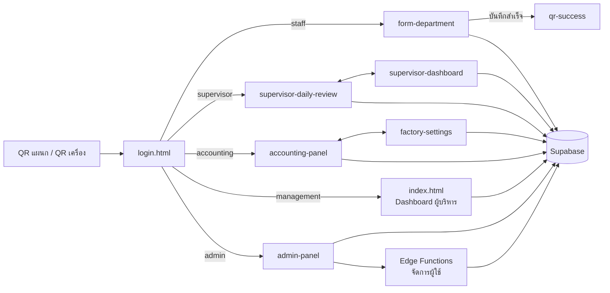
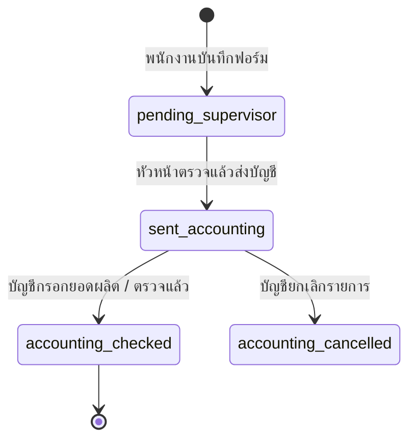

# สถาปัตยกรรมระบบ — รายหน้า

**ระบบ:** EA-Factory (PVT&T FACTORY) — ระบบบันทึกและตรวจสอบของเสียในโรงงาน
**อัปเดต:** 30 ต.ค. 2569 (หลังปรับหน้าตาแบบเรียบรอบล่าสุด)

เอกสารนี้อธิบายว่าแต่ละหน้าในระบบ ใครใช้ โหลดไฟล์อะไร อ่าน/เขียนตารางไหนใน Supabase และส่งต่อไปหน้าไหน
เพื่อใช้เป็นแผนที่ตอนแก้ไขหรือเพิ่มฟีเจอร์

---

## 1. ภาพรวม

| ส่วน | เทคโนโลยี |
|---|---|
| หน้าเว็บ | HTML + JavaScript ธรรมดา (โหลดด้วย `<script src>` ไม่ใช้ module / framework) |
| ฐานข้อมูล + Login | Supabase (Postgres + Auth + RLS) ผ่าน `@supabase/supabase-js@2` จาก CDN |
| งานที่ต้องใช้สิทธิ์สูง | Supabase Edge Functions (Deno): `admin-create-user`, `admin-update-user`, `admin-delete-user` |
| กราฟ | Chart.js 4 (และ d3 7 เฉพาะหน้า Dashboard ผู้บริหาร) |
| สแกน QR | `js/vendor/html5-qrcode.min.js` |
| Build | Vite — คัดลอกโฟลเดอร์ `core, auth, services, js, css, images, icons` ไปที่ `dist/` ตรง ๆ (ไม่ bundle) |



### 1.1 เส้นทางของรายงานของเสีย (สถานะ `daily_waste_reports.status`)



| สถานะ | ข้อความที่แสดง | ใครเปลี่ยน |
|---|---|---|
| `pending_supervisor` (ข้อมูลเก่าอาจเป็น `pending`) | รอหัวหน้าตรวจ | สร้างจากหน้าฟอร์ม |
| `sent_accounting` | รอบัญชีตรวจ | หน้าตรวจสอบรายวัน (หัวหน้า) |
| `accounting_checked` | บัญชีตรวจแล้ว | หน้าบัญชี |
| `accounting_cancelled` | ยกเลิกรายการ | หน้าบัญชี |

ข้อความสถานะกลางอยู่ที่ `core/ea-common.js` → `STATUS_LABELS`

### 1.2 Role และหน้าแรกหลัง Login (`core/roleConfig.js`)

| Role | ชื่อไทย | หน้าแรก |
|---|---|---|
| `staff` | พนักงาน | `/pages/form-department.html` |
| `supervisor` | หัวหน้างาน | `/pages/supervisor-daily-review.html` |
| `accounting` | ฝ่ายบัญชี | `/pages/accounting-panel.html` |
| `management` | ผู้บริหาร | `/index.html` |
| `admin` | ผู้ดูแลระบบ | `/pages/admin-panel.html` |

แผนกไม่ใช่ role — เก็บใน `profiles.department_code` และ `user_departments` (หัวหน้าดูแลได้หลายแผนก)

---

## 2. ชั้นที่ใช้ร่วมกันทุกหน้า

### 2.1 JavaScript กลาง

| ไฟล์ | หน้าที่ |
|---|---|
| `core/supabaseClient.js` | สร้าง `window.supabaseClient` (URL + anon key) |
| `auth/authGuard.js` | `AUTH_GUARD.requireLogin([roles])` ตรวจ session จริงกับ Supabase Auth + role จาก `profiles` ถ้าไม่ผ่านพาไป `/login.html`; `saveProfileSession`, `logoutAndRedirect` |
| `core/roleConfig.js` | รายชื่อ role, ชื่อไทย, หน้าแรกของแต่ละ role, รายชื่อแผนก |
| `core/departmentConfig.js` | ข้อมูลแผนก/ชื่อไทยที่หน้าต่าง ๆ ใช้ร่วม |
| `core/ea-common.js` | ฟังก์ชันกลาง: แปลงชื่อแผนก, ข้อความสถานะ, escape HTML |
| `core/supabaseFetch.js` | `SB_FETCH` ดึงข้อมูลแบบแบ่งหน้า (เกิน 1,000 แถวของ Supabase ได้) สำหรับ `daily_waste_reports` / `daily_waste_report_items` |
| `core/wasteFormula.js` | สูตร % ของเสีย |
| `core/wasteStandardService.js` | อ่าน/บันทึกเกณฑ์ของเสียรายแผนก (`master_departments`) และรายเครื่อง (`machine_waste_standards`) พร้อม cache |
| `core/activityLogger.js` | เขียนประวัติการใช้งานลง `user_activity_logs` |
| `core/responsiveTables.js` | ใส่ `data-label` ให้เซลล์ตาราง เพื่อแสดงเป็นการ์ดบนจอเล็ก |
| `js/department/formSettings.js` | ปุ่ม **A+** — เลือกฟอนต์และขนาดตัวอักษร (เก็บใน localStorage, โหลดฟอนต์ Google เฉพาะที่เลือก) |

### 2.2 CSS แบบเรียบ (ชุดใหม่)

หน้าที่ปรับแล้วโหลด CSS ซ้อนกันเป็นชั้น ไฟล์หลังต่อยอดไฟล์ก่อน:

```
form-mobile.css      ← ตัวแปรสี/ฟอนต์ (--primary, --fs, --font), หัวหน้า fm-top + โลโก้, แถบไอคอนล่าง, หน้าต่างตั้งค่า
  └ review-simple.css     ← การ์ด, ปุ่ม, ตาราง (เป็นการ์ดบนจอ < 900px), modal, toast
      └ accounting-simple.css  ← โครงหน้าคอม: เมนูซ้ายสีน้ำเงิน + แถบส้ม (จอ 1024–1439 แสดงแค่ไอคอน)
          ├ settings-simple.css   (factory-settings)
          └ admin-simple.css      (admin-panel)
      └ dashboard-simple.css  (supervisor-dashboard)
```

- โลโก้หัวหน้าใช้ `icons/logo-header.png` (ไฟล์เล็ก ~7KB)
- ไอคอนเป็น SVG ในหน้า ไม่โหลดฟอนต์ไอคอน (Material Symbols)

### 2.3 ตารางในฐานข้อมูลที่ใช้บ่อย

| ตาราง | เก็บอะไร |
|---|---|
| `daily_waste_reports` | หัวรายงานของเสีย (วันที่, แผนก, เครื่อง, กะ, ผู้แจ้ง, น้ำหนัก, สถานะ) |
| `daily_waste_report_items` | รายการปัญหาย่อยในแต่ละรายงาน |
| `daily_machine_status` | สถานะเครื่องรายวัน (มีของเสีย / ไม่มี / ไม่เดิน) + ยอดผลิต `production_kg` |
| `master_departments` | แผนก + เกณฑ์ % ของเสียรายแผนก |
| `master_machines`, `master_problems`, `master_shifts` | ข้อมูลพื้นฐาน: เครื่องจักร, อาการเสีย, กะ |
| `pvt_machines`, `pvt_problem_types` | ข้อมูลพื้นฐานชุดเดิม (ยังอ่านเพื่อรองรับข้อมูลเก่า) |
| `machine_waste_standards` | เกณฑ์ % ของเสียรายเครื่อง |
| `master_problems.loss_type`, `daily_waste_report_items.loss_type` | ประเภทของเสีย: สูญเสียจากการผลิต / สูญเสียบังคับ (database/12) |
| `profiles`, `user_departments` | ผู้ใช้, role, แผนกที่รับผิดชอบ |
| `daily_production_lines` | ยอดผลิตแยก กะ / สินค้า / จำนวน ต่อเครื่องต่อวัน (database/13) — ผลรวมบันทึกลง production_kg |
| `department_qr_tokens` | token ของ QR แผนก (ใช้ตอน QR Login) |
| `accounting_production_log` | ประวัติการแก้ยอดผลิต (trigger บันทึกอัตโนมัติ) |
| `accounting_period_locks`, `accounting_period_lock_events` | ปิดงวดบัญชีรายเดือน + ประวัติ |
| `user_activity_logs` | ประวัติการใช้งาน |

สิทธิ์ (RLS) ชุดล่าสุดอยู่ใน `database/11-security-hardening.sql`

---

## 3. รายหน้า

### 3.1 `login.html` — เข้าสู่ระบบ

| หัวข้อ | รายละเอียด |
|---|---|
| ผู้ใช้ | ทุกคน (ยังไม่ login) |
| สไตล์ | แบบเดิม — `login.css`, `login-app.css`, `app-shell.css`, `responsive.css`, `splash.css`, `loadingService.css`, `offline-queue.css` |
| JS | `core/appShell.js`, `supabaseClient`, `activityLogger`, `roleConfig`, `authGuard`, `services/loadingService.js`, `auth/login.js`, `js/department/offlineQueue.js`, `html5-qrcode` |
| ตาราง | อ่าน `profiles`, `department_qr_tokens` · เขียน `user_activity_logs` |

**การทำงาน**
1. Login ด้วย username/password ผ่าน Supabase Auth แล้วอ่าน role จาก `profiles` → `AUTH_GUARD.saveProfileSession()` → ไปหน้าแรกตาม role
2. **QR Login**: `login.html?dept=BLOW&token=...` ตรวจ token กับ `department_qr_tokens` แล้วให้เลือกชื่อพนักงาน → ไปหน้าฟอร์ม (session แบบ local ไม่มี Supabase session)
3. ปุ่มสแกน QR (`#scan`) เปิดกล้องอ่าน QR แผนก/เครื่อง
4. ส่งรายงานที่ค้างไว้ตอนออฟไลน์ (offlineQueue) เมื่อกลับมาออนไลน์

---

### 3.2 `pages/form-department.html` — บันทึกของเสีย (แอปมือถือ)

| หัวข้อ | รายละเอียด |
|---|---|
| ผู้ใช้ | `staff`, `supervisor`, `admin` หรือผู้ที่เข้าผ่าน QR Login |
| URL | `?dept=BLOW` (QR แผนก) · `?dept=BLOW&machine=BLOW-01` (QR รายเครื่อง เลือกเครื่องให้อัตโนมัติ) |
| สไตล์ | `form-mobile.css` อย่างเดียว — หัวหน้ามีโลโก้, แถบไอคอนล่าง: ล้างข้อมูล · สแกน QR · **บันทึก** |
| JS | `formSettings.js`, `supabaseClient`, `activityLogger`, `ea-common`, `js/department/form-department.js`, `js/department/offlineQueue.js` |
| ตาราง | อ่าน `master_machines`, `master_problems`, `master_shifts` (+ `pvt_machines`, `pvt_problem_types` สำรอง) · เขียน `daily_waste_reports` (status = `pending_supervisor`), `daily_waste_report_items`, `user_activity_logs` |
| ไปต่อ | บันทึกสำเร็จ → `qr-success.html` |

**จุดสำคัญ**
- ออฟไลน์: ถ้าไม่มีเน็ต เก็บรายงานไว้ใน localStorage (`offlineQueue.js`) แล้วส่งเองเมื่อออนไลน์
- ออกจากระบบอัตโนมัติเมื่อไม่ได้ใช้งาน (`startAutoLogoutTimer`)
- ตั้งค่าฟอนต์/ขนาดตัวอักษรที่ปุ่ม A+ ใช้ร่วมกับทุกหน้าที่ปรับแล้ว

---

### 3.3 `pages/qr-success.html` — บันทึกสำเร็จ

| หัวข้อ | รายละเอียด |
|---|---|
| ผู้ใช้ | ผู้ที่เพิ่งส่งฟอร์ม |
| สไตล์ | แบบเดิม — `responsive.css`, `app-shell.css` (สคริปต์และสไตล์ส่วนใหญ่เขียนในไฟล์ HTML) |
| JS | `core/appShell.js`, `html5-qrcode`, `responsiveTables` |
| ตาราง | ไม่มี |

**การทำงาน:** แสดงผลบันทึกสำเร็จ, ปุ่มสแกน QR เครื่องถัดไป (ถ้าเป็นลิงก์ของระบบจะเปิดฟอร์มต่อ), ปุ่มออกจากระบบ (ล้าง localStorage แล้วกลับ `login.html`)

---

### 3.4 `pages/supervisor-daily-review.html` — ตรวจสอบรายวัน (หัวหน้า)

| หัวข้อ | รายละเอียด |
|---|---|
| ผู้ใช้ | `supervisor`, `management`, `admin` |
| สไตล์ | `form-mobile.css` + `review-simple.css` — responsive ทุกขนาดจอ (ตารางเป็นการ์ดบนจอ < 900px) |
| JS | `formSettings`, `supabaseClient`, `supabaseFetch`, `activityLogger`, `roleConfig`, `ea-common`, `departmentConfig`, `authGuard`, `js/dashboard/supervisor-daily-review.js`, `responsiveTables` |
| ตาราง | อ่าน `daily_waste_reports`, `daily_waste_report_items`, `master_departments`, `master_machines`, `user_departments`, `daily_machine_status` · เขียน `daily_waste_reports` (แก้ไข / ลบ / เปลี่ยนสถานะ), `daily_waste_report_items`, `daily_machine_status` (upsert) |
| ไปต่อ | `supervisor-dashboard.html` |

**การทำงาน**
1. เลือกวัน + แผนก (หัวหน้าเห็นเฉพาะแผนกใน `user_departments`; admin/management เห็นทุกแผนก)
2. ดูรายการที่ `pending_supervisor` แก้น้ำหนัก/อาการ หรือลบรายการผิด
3. ระบุสถานะเครื่องที่ไม่มีรายงาน: `has_waste` / `no_waste` / `not_running` → `daily_machine_status`
4. กด **ส่งบัญชี** → status = `sent_accounting`

---

### 3.5 `pages/supervisor-dashboard.html` — Dashboard ของเสีย (หัวหน้า)

| หัวข้อ | รายละเอียด |
|---|---|
| ผู้ใช้ | `supervisor`, `manager`, `management`, `executive`, `admin` (admin/management/executive เห็นทุกแผนก) |
| สไตล์ | `form-mobile.css` + `review-simple.css` + `dashboard-simple.css` |
| JS | `formSettings`, Chart.js, `supabaseClient`, `supabaseFetch`, `authGuard`, `roleConfig`, `ea-common`, `departmentConfig`, `wasteFormula`, `js/dashboard/supervisor-dashboard.js`, `js/dashboard/qr-machine-scanner.js`, `html5-qrcode` |
| ตาราง | อ่านอย่างเดียว: `daily_waste_reports`, `daily_waste_report_items`, `master_departments`, `user_departments` |

**การทำงาน:** การ์ด KPI (มีลูกศรเทียบช่วงก่อน), กราฟแนวโน้ม/รายเครื่อง/รายอาการ, เลือกช่วงวัน, สแกน QR เครื่องเพื่อเปิดดูข้อมูลเครื่องนั้น

---

### 3.6 `pages/accounting-panel.html` — บัญชีตรวจสอบของเสีย (เน้นคอมพิวเตอร์)

| หัวข้อ | รายละเอียด |
|---|---|
| ผู้ใช้ | `accounting`, `admin`, `management` (แท็บ Dashboard เห็นเฉพาะ admin/management) |
| สไตล์ | `form-mobile.css` + `review-simple.css` + `accounting-simple.css` — เมนูซ้ายสีน้ำเงิน, จอเล็กเป็นแถบไอคอนล่าง |
| JS | `formSettings`, `supabaseClient`, `supabaseFetch`, `activityLogger`, `roleConfig`, `ea-common`, `authGuard`, `wasteFormula`, `wasteStandardService`, `js/accounting/accounting-panel.js`, Chart.js, `js/accounting/accounting-dashboard.js`, `responsiveTables`, `js/accounting/accountingSimpleNav.js`, `js/accounting/productionLines.js` |
| ตาราง | อ่าน `daily_waste_reports`, `daily_waste_report_items`, `daily_machine_status`, `master_departments`, `master_problems`, `pvt_problem_types`, `machine_waste_standards`, `accounting_production_log` · เขียน `daily_waste_reports` (ตรวจแล้ว / ยกเลิก / เพิ่ม), `daily_waste_report_items`, `daily_machine_status` (ยอดผลิต), `accounting_period_locks` |
| ไปต่อ | `factory-settings.html` · ลิงก์ `#dashboard`, `#summary`, `#pending` เปิดส่วนนั้นตรง ๆ |

**การทำงาน**
1. ตารางรวมรายงานตามวัน/แผนก/เครื่อง กรองสถานะ (เมนู "รอตรวจ" = `sent_accounting`)
2. กรอกยอดผลิต (`production_kg`) → คำนวณ % ของเสียเทียบเกณฑ์ (แผนก/เครื่อง) — การแก้ยอดถูกบันทึกลง `accounting_production_log` อัตโนมัติ
3. ตรวจแล้ว → `accounting_checked` · ยกเลิกกลุ่มรายการ → `accounting_cancelled`
4. ปิดงวดรายเดือน (`accounting_period_locks`) — งวดที่ปิดแล้วแก้ไม่ได้
5. สรุปรายเดือน + ส่งออก CSV, Dashboard กราฟ

---

### 3.7 `pages/factory-settings.html` — ตั้งค่าเกณฑ์ของเสีย

| หัวข้อ | รายละเอียด |
|---|---|
| ผู้ใช้ | `accounting`, `admin` |
| สไตล์ | `form-mobile.css` + `review-simple.css` + `accounting-simple.css` + `settings-simple.css` (เมนูซ้ายชุดเดียวกับหน้าบัญชี) |
| JS | `formSettings`, `supabaseClient`, `authGuard`, `roleConfig`, `departmentConfig`, `wasteFormula`, `wasteStandardService`, `js/accounting/factory-settings.js`, `accountingSimpleNav.js` |
| ตาราง | อ่าน/เขียน `master_departments` (เกณฑ์), `machine_waste_standards` (upsert/ลบ), `master_machines`, `master_problems` (เพิ่ม / เปิด-ปิด / ลำดับ / ลบ) |

**แท็บ:** เกณฑ์รายแผนก · เกณฑ์รายเครื่อง · เครื่องจักร · หัวข้อปัญหา
แถบช่วงเกณฑ์ใช้สีเขียว/เหลือง/แดงตามความหมาย (ปกติ / เตือน / เกิน)
เมนูซ้าย "ข้อมูล / Dashboard / สรุป / รอตรวจ" กดแล้วไปหน้าบัญชีส่วนนั้น

---

### 3.7.1 `pages/loss-settings.html` — อาการเสีย & ประเภท

| หัวข้อ | รายละเอียด |
|---|---|
| ผู้ใช้ | `admin`, `accounting`, `management` |
| สไตล์ | ชุดเดียวกับหน้าตั้งค่า + `loss-settings.css` |
| JS | `formSettings`, `supabaseClient`, `authGuard`, `roleConfig`, `js/accounting/loss-settings.js`, `accountingSimpleNav.js` |
| ตาราง | อ่าน `master_departments` · อ่าน/เขียน `master_problems` (ชื่อ, ลำดับ, เปิด-ปิด, `loss_type`) |

ประเภทถูกเก็บลงแต่ละรายการของเสียตอนบันทึก (trigger ใน database/12) จึงเปลี่ยนภายหลังได้โดยรายงานเก่าไม่ขยับ

---

### 3.7.2 `pages/daily-report.html` — รายงานการผลิตและของเสีย (แบบใบตรวจสอบ)

| หัวข้อ | รายละเอียด |
|---|---|
| ผู้ใช้ | `admin`, `accounting`, `management`, `supervisor` (หัวหน้าเห็นเฉพาะแผนกที่รับผิดชอบ) |
| สไตล์ | ชุดเรียบ + `daily-report.css` (มีสไตล์พิมพ์ A4 แนวนอน) |
| JS | `supabaseClient`, `supabaseFetch`, `authGuard`, `roleConfig`, `wasteFormula`, `js/accounting/daily-report.js`, `accountingSimpleNav.js` |
| ตาราง | อ่านอย่างเดียว: `daily_waste_reports`, `daily_waste_report_items`, `daily_production_lines`, `daily_machine_status`, `master_departments`, `master_machines`, `user_departments` |

รายวัน / รายเดือน · แผนกที่ `dept_kind = recycle` (database/14) แสดงเป็นตารางเครื่องรีไซเคิลแยกท้ายใบ

---

### 3.7.3 `pages/production-entry.html` — กรอกยอดผลิตทั้งใบ

| หัวข้อ | รายละเอียด |
|---|---|
| ผู้ใช้ | `admin`, `accounting`, `management` |
| สไตล์ | ชุดเรียบ + `production-entry.css` |
| JS | `supabaseClient`, `supabaseFetch`, `authGuard`, `roleConfig`, `wasteFormula`, `js/accounting/production-entry.js`, `accountingSimpleNav.js` |
| ตาราง | อ่าน `master_departments`, `master_machines`, `daily_waste_report_items`, `accounting_period_locks` · อ่าน/เขียน `daily_production_lines`, `daily_waste_reports` (production_kg + สถานะบัญชีตรวจแล้ว), `daily_machine_status` (production_kg) |

---

### 3.7.4 `pages/dept-groups.html` — กลุ่มแผนก

| หัวข้อ | รายละเอียด |
|---|---|
| ผู้ใช้ | `admin`, `accounting`, `management` |
| JS | `js/accounting/dept-groups.js` |
| ตาราง | อ่าน/เขียน `department_groups` · ย้ายแผนกผ่าน RPC `pvt_set_department_group` (`master_departments.group_code`) — database/16 |

ใช้ในหน้าบัญชี (สรุปตามกลุ่ม) และรายงานประจำวัน (แถวรวมกลุ่ม)

---

### 3.8 `pages/admin-panel.html` — ผู้ดูแลระบบ (เน้นคอมพิวเตอร์)

| หัวข้อ | รายละเอียด |
|---|---|
| ผู้ใช้ | `admin` หรือ `profiles.is_system_owner = true` |
| สไตล์ | `form-mobile.css` + `review-simple.css` + `accounting-simple.css` + `admin-simple.css` — เมนูซ้ายสีน้ำเงิน, จอเล็กเป็นแถบเมนูเลื่อนแนวนอนด้านบน |
| JS | `formSettings`, `supabaseClient`, `roleConfig`, `departmentConfig`, `authGuard`, `services/popupService.js`, `js/admin/admin-panel.js`, `responsiveTables`, `core/adminDesktop.js` |
| ตาราง | อ่าน/เขียน `master_departments`, `master_machines`, `master_problems`, `master_shifts`, `pvt_machines`, `pvt_problem_types`, `profiles`, `user_departments` · อ่าน `daily_waste_reports`, `user_activity_logs` |
| Edge Functions | `admin-create-user`, `admin-update-user`, `admin-delete-user` (สร้าง/แก้/ลบบัญชีใน Supabase Auth ต้องใช้ service role จึงทำฝั่งเซิร์ฟเวอร์) |

**เมนู (`data-section`)**

| เมนู | ทำอะไร |
|---|---|
| Dashboard | สถานะการเชื่อมต่อ, จำนวนรายการ, รอตรวจ, น้ำหนักรวม, ตารางรายการล่าสุด + CSV |
| Master Data | แผนก, กะ, เครื่องจักรตามแผนก, อาการเสียตามแผนก (เพิ่ม/แก้/ลำดับ/เปิด-ปิด/ลบ) |
| Users / Role | เพิ่ม/แก้/ลบผู้ใช้, role, แผนกหลัก, แผนกที่รับผิดชอบหลายแผนก |
| QR แผนก / QR เครื่อง | สร้าง QR, คัดลอกลิงก์, พิมพ์ทั้งแผนก |
| System Logs | log การทำงานของหน้า admin ในรอบที่เปิดอยู่ (เก็บในหน่วยความจำ ไม่ได้บันทึกลงฐานข้อมูล) |
| การใช้งานระบบ | ประวัติการใช้งานผู้ใช้จาก `user_activity_logs` |

`core/adminDesktop.js` เพิ่ม: แบ่งหน้าตาราง (25/50/100/ทั้งหมด), คีย์ลัด `/` ค้นหา และ `←` `→` เปลี่ยนหน้า, ข้อความแนะนำให้ใช้บน PC (เฉพาะจอเล็ก)

---

### 3.9 `index.html` — Dashboard ผู้บริหาร

| หัวข้อ | รายละเอียด |
|---|---|
| ผู้ใช้ | `admin`, `management`, `manager`, `executive` |
| สไตล์ | แบบเรียบ — `form-mobile.css`, `review-simple.css`, `accounting-simple.css`, `exec-dashboard-simple.css` (เมนูซ้ายน้ำเงิน `acc-side`) |
| JS | `supabaseClient`, `supabaseFetch`, `authGuard`, Chart.js, `wasteFormula`, `js/dashboard/index.js`, `accountingSimpleNav.js`, `formSettings.js` |
| ตาราง | อ่านอย่างเดียว: `daily_waste_reports`, `daily_waste_report_items` (+`loss_type`), `daily_machine_status`, `master_departments` (+`threshold_basis`, `dept_kind`, `group_code`), `department_groups` |

**การทำงาน:** สรุปภาพรวมรายเดือนทั้งโรงงาน · ตารางแผนกจัดตามกลุ่ม (แถวรวมกลุ่มใช้เกณฑ์ของกลุ่ม) + แถวรวมทั้งโรงงาน · แยกของเสียจากการผลิต/บังคับ · ประเมินตาม "เกณฑ์คิดจาก" ของแผนก · ไม่รวมแผนกรีไซเคิล · % รายเครื่อง / อาการ · หน้าต่างประวัติเครื่อง (แจ้งซ่อม: เวอร์ชันถัดไป) · ส่งออก CSV / PDF

---

## 4. ตารางสรุป หน้า × ข้อมูล

อ = อ่าน · ข = เขียน (เพิ่ม/แก้/ลบ)

| ตาราง | login | form | review | s-dash | acc | settings | admin | index |
|---|:-:|:-:|:-:|:-:|:-:|:-:|:-:|:-:|
| daily_waste_reports | | ข | อ ข | อ | อ ข | | อ | อ |
| daily_waste_report_items | | ข | อ ข | อ | อ ข | | | อ |
| daily_machine_status | | | อ ข | | อ ข | | | อ |
| master_departments | | | อ | อ | อ | อ ข | อ ข | อ |
| master_machines / problems | | อ | อ | | อ | อ ข | อ ข | |
| master_shifts | | อ | | | | | อ ข | |
| machine_waste_standards | | | | | อ | อ ข | | |
| profiles / user_departments | อ | | อ | อ | | | อ ข | |
| department_qr_tokens | อ | | | | | | | |
| accounting_period_locks | | | | | อ ข | | | |
| user_activity_logs | ข | ข | ข | | ข | | อ | |

---

## 5. โครงสร้างโฟลเดอร์

```
index.html, login.html        หน้าหลักนอก pages/
pages/                         หน้าอื่นทั้งหมด (3.2–3.8)
css/                           สไตล์ (ชุดเรียบ: form-mobile, review-simple, accounting-simple, settings-simple, admin-simple, dashboard-simple)
core/                          JS กลาง (ข้อ 2.1)
auth/                          authGuard.js, login.js
services/                      loadingService.js, popupService.js
js/department|dashboard|accounting|admin/   JS เฉพาะหน้า
js/vendor/                     html5-qrcode
icons/, images/                โลโก้ / ไอคอน PWA
supabase/functions/            Edge Functions จัดการผู้ใช้ (+ _shared/auth.ts ตรวจสิทธิ์ admin)
database/                      SQL ตั้งค่าฐานข้อมูล รันตามลำดับเลข (01–11)
```

### ลำดับไฟล์ SQL ที่สำคัญ
- `07-ensure-app-schema.sql` — สร้าง/เติมคอลัมน์ที่แอปต้องใช้
- `09-accounting-controls.sql` — ประวัติแก้ยอดผลิต + ปิดงวดบัญชี
- `10-machine-waste-standards.sql` — เกณฑ์รายเครื่อง
- `11-security-hardening.sql` — RLS ชุดใหม่ (รันหลัง 07, 09, 10)

---

## 6. สถานะการปรับหน้าตา

| หน้า | แบบ |
|---|---|
| form-department, supervisor-daily-review, supervisor-dashboard, accounting-panel, factory-settings, admin-panel | ✅ แบบเรียบชุดใหม่ |
| index.html | ✅ แบบเรียบ |
| login, qr-success | ⏳ แบบเดิม (ยังใช้ `responsive.css`, `splash.css`, `loadingService.css`, `responsiveTables.js`) |


---

### เมนูหน้ากลุ่มสีน้ำเงิน (ชุดเดียว)
สร้างโดย `js/accounting/accountingSimpleNav.js` (รายการ `MENU` / `TABS`) — ทุกหน้าใช้ `<nav class="acc-side">` และ `<nav class="fm-tabbar acc-tabbar">` ว่าง ๆ
เมนูแสดงตามสิทธิ์: ภาพรวม (Dashboard ผู้บริหาร: admin/management/manager/executive · รายงานประจำวัน: ทุกสิทธิ์รวม supervisor) ·
งานบัญชี / อาการเสีย / กลุ่มแผนก: admin/accounting/management · ตั้งค่าเกณฑ์: admin/accounting · ตรวจสอบรายวัน: supervisor/admin · หน้าแอดมิน: admin
